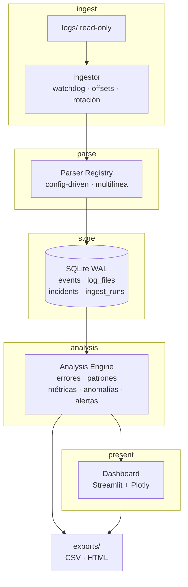

# Enterprise Log Analyzer

Plataforma de observabilidad y análisis de logs para entornos empresariales. Carga logs
de forma incremental, los normaliza, detecta errores críticos, agrupa patrones
recurrentes y expone métricas en un dashboard interactivo con exportación de reportes.

**Estado:** en desarrollo activo. Fases 0–4 completadas (177 tests + 5 smoke tests dashboard, saltados sin Streamlit) — ver
[docs/PLAN.md](docs/PLAN.md).

---

## Por qué este proyecto no es "otro visor de logs"

Un visor de logs que duplica eventos miente. Este proyecto se construye sobre tres
invariantes, y cada uno tiene una razón concreta:

| Invariante | Problema que resuelve |
|---|---|
| **Idempotencia de ingesta** | Sin ella, reiniciar el watcher duplica eventos y el dashboard reporta números falsos |
| **UTC como storage canónico** | Logs de distintos servicios llegan en zonas distintas; sin normalizar, "errores por hora" es incorrecto |
| **Líneas no parseadas se conservan** | Descartar lo que no se entiende hace la pérdida de datos invisible |

Las decisiones de arquitectura y sus alternativas descartadas están en
[`docs/decisions/`](docs/decisions/).

---

## Arquitectura



En Docker (Fase 6) `Ingestor` y `Dashboard` son **servicios separados**: eso elimina la
contención de escritura de SQLite por diseño, no por ajuste de parámetros.

### Capa de ingesta (añadida al diseño original)

El flujo original iba de `logs/` directo al parser. Eso rompe en producción por dos
motivos, y por eso la ingesta es una capa propia:

- **Tracking de offset**: se lee solo lo nuevo, y se sabe exactamente dónde quedó cada archivo.
- **Detección de rotación**: un log rotado por tamaño se reinicia a 0; si no se detecta,
  todo su contenido se vuelve a insertar.

---

## Estructura

```
Enterprise-Log-Analyzer/
├── app/
│   ├── config.py               Settings tipados · YAML + env
│   ├── ingest/
│   │   ├── reader.py           offset, rotación, ensamblado multilínea
│   │   └── watcher.py          watchdog con debounce
│   ├── parser/
│   │   ├── registry.py         PatternSpec · detect() · parse()
│   │   ├── patterns/           apachev2.yaml · iis.yaml · weblogic.yaml · json.yaml
│   │   └── normalization.py    timestamp → UTC · nivel → severity
│   ├── db/
│   │   ├── connection.py       WAL · busy_timeout · contextmanager
│   │   ├── schema.sql  migrations/  repository.py
│   ├── analysis/
│   │   ├── error_rules.yaml     categorías de error · orden = prioridad
│   │   ├── errors.py            ErrorRules · validación al cargar
│   │   ├── fingerprint.py       normalización · sha256
│   │   ├── metrics.py  patterns.py  anomalies.py  backfill.py
│   │   └── __main__.py          CLI: python -m app.analysis
│   ├── ui/
│   │   ├── app.py  pages/  components/  theme.py
│   └── reports/                CSV · HTML
├── docs/
│   ├── PLAN.md                 hoja de ruta completa
│   └── decisions/              ADR-001, ADR-002, …
├── logs/                       entrada (read-only en Docker)
├── data/                       app.db
├── exports/                    reportes generados
├── tools/generate_sample_logs.py
├── tests/
│   ├── fixtures/               logs golden por formato
│   └── expected/               JSONL con la salida esperada
├── config.yaml  .env.example
├── requirements.txt  requirements-dev.txt
└── Dockerfile  docker-compose.yml  Makefile
```

---

## Configuración

Todo se declara en `config.yaml`; las variables de entorno tienen prioridad para permitir
overrides en Docker sin editar archivos.

```bash
cp .env.example .env
cp config.yaml config.local.yaml   # opcional: overrides locales
```

Las claves de entorno siguen el patrón `ELA_` + ruta en mayúsculas:
`ELA_DB_PATH`, `ELA_LOG_DIR`, `ELA_POLL_INTERVAL`.

---

## Puesta en marcha

```bash
python -m venv .venv && source .venv/bin/activate
pip install -r requirements.txt -r requirements-dev.txt

# 1. Crear la base de datos y aplicar el esquema
python -m app.db.migrations

# 2. Generar un dataset sintético para el demo
python tools/generate_sample_logs.py

# 3. Ingerir los logs (idempotente: una 2ª pasada inserta 0)
python -m app.ingest --once
python -m app.ingest --status     # cobertura de parseo y últimas pasadas

# 4. Analizar (sin necesidad de dashboard)
python -m app.analysis                  # resumen general
python -m app.analysis --top 8          # errores agrupados por fingerprint
python -m app.analysis --hourly         # errores por hora
python -m app.analysis --anomalies      # z-score sobre el conteo horario
python -m app.analysis --patterns       # patrones en la última ventana
python -m app.analysis --backfill       # rellena la huella de datos antiguos

# 5. Lanzar el dashboard (Fase 4)
streamlit run app/ui/app.py
```

O en un solo paso: `make demo`.

### Verificar la instalación

```bash
make test        # o: python -m unittest discover -s tests -t .
make check-db    # debe imprimir: journal_mode = wal

# Golden files: falla si la salida del parser cambió sin regenerarlos.
python -m tests.regenerate_golden --check
python -m tests.regenerate_golden   # regenera (revisar el diff antes de aceptar)
```

---

## Stack

| Capa | Tecnología | Razón |
|---|---|---|
| Backend | Python, SQLite | Cero operación; SQLite con WAL resuelve concurrencia lector/escritor |
| Parsing | Regex compilados con *named groups*, config-driven | Agregar un formato es agregar YAML, no código |
| Análisis | SQL + Pandas | Agregación en SQL; nunca cargar la tabla completa en memoria |
| Frontend | Streamlit, Plotly | Dashboard declarativo, heatmap listo |
| Ingesta | watchdog | Detección de cambios en archivos |
| DevOps | Docker, Docker Compose | Servicios separados, volúmenes para `data/` y `exports/` |

---

## Funcionalidades

### En el MVP (fases 0–5)

1. ✅ **Parser inteligente** — detecta `timestamp`, `nivel`, `mensaje`, `servicio`,
   `logger` desde configuración, con normalización a UTC.
2. ✅ **Ingesta idempotente** — offsets, rotación, ensamblado multilínea (stack traces Java).
3. ✅ **Detección de errores críticos** — `timeout`, `connection refused`,
   `null pointer`, `out of memory`, `failed login`, con categorías (reglas en
   YAML) y severidad normalizada.
4. ✅ **Patrones recurrentes** — fingerprint por mensaje normalizado (dígitos, UUIDs,
   IPs y hex colapsan a placeholders) para agrupar lo que en realidad es el mismo
   error, más recurrencia por ventana y anomalías por z-score.
5. ✅ **Dashboard** — KPIs, errores por hora, top errores, timeline, heatmap día×hora (4 páginas: Overview/Events/Incidents/Settings).
6. *(Fase 5)* **Alertas** — incidentes con dedup por fingerprint y cooldown; export CSV/HTML.
7. **Métricas de la propia herramienta** — `ingest_runs` ya se registra en cada
   pasada; el panel llega con el dashboard.

### Post-MVP (backlog, ver [docs/PLAN.md](docs/PLAN.md) §6)

- Formato IIS
- Anomalías avanzadas (IQR, estacionalidad)
- Correlación de eventos
- Búsqueda estilo Splunk
- Export PDF · auth · multi-tenancy · PostgreSQL · Prometheus

---

## Formatos soportados

Cada formato es **un archivo YAML** en `app/parser/patterns/`. Agregar IIS o
WebLogic es agregar un archivo, no escribir Python — ver
[ADR-002](docs/decisions/ADR-002-parsers-declarativos.md).

| Formato | `kind` | Estado |
|---|---|---|
| Apache / Nginx (CLF) | `regex` | ✅ implementado |
| JSON (una línea por registro) | `json` | ✅ implementado |
| WebLogic / java.util.logging | `regex` | ✅ implementado (multilínea) |
| IIS | `regex` | backlog |

Un patrón `regex` **debe** declarar el grupo con nombre `ts`; `level`, `service`,
`logger`, `status` y `message` son opcionales. El contrato se verifica al cargar
los patrones, no durante la ingesta: un YAML incompleto rompe el arranque.

Para JSON se declaran listas de claves candidatas por campo, con rutas de punto:

```yaml
fields:
  level: [level, levelname, severity, loglevel, log.level]
  message: [message, msg, '@message', log, log.message]
```

---

## Sistema de severidad

Niveles crudos (diferentes por formato) se normalizan a una escala única:

```
TRACE 10 · DEBUG 20 · INFO 30 · WARN 40 · ERROR 45 · FATAL 50 · UNKNOWN 0
```

`UNKNOWN` se asigna a líneas no parseadas. Se conservan y se hacen visibles en el
dashboard como "cobertura de parseo", en lugar de descartarse en silencio.

---

## Clasificación y agrupación

Dos preguntas distintas, dos columnas nuevas en `events`:

- **`category` — ¿qué tipo de problema es?** Sale de
  `app/analysis/error_rules.yaml`: una lista ordenada donde **gana la primera
  regla que coincide** (`failed login` → `auth`, `connection refused` →
  `connection`, 5xx → `http-5xx`). Añadir una categoría es añadir una regla,
  no código. Un YAML mal formado falla **al cargar**, nunca durante la ingesta.
- **`fingerprint` — ¿es otra vez el mismo error?** `sha256` truncado a 16 hex
  sobre `categoría + mensaje normalizado`, donde lo que varía entre ejecuciones
  se sustituye por `<UUID> <TS> <IP> <HEX> <NUM>`. 100 accesos fallidos que
  sólo cambian en `code=` son **1** fingerprint, no 100 barras de una unidad.

El orden de esas sustituciones y las alternativas descartadas están en
[ADR-004](docs/decisions/ADR-004-event-fingerprint.md).

### Métricas

Todo se agrega en SQL; ninguna carga la tabla `events` entera en memoria.

| Comando | Qué responde |
|---|---|
| `python -m app.analysis` / `--overview` | cuántos eventos, cuántos parseados, cuántos errores, fingerprints distintos |
| `--hourly` | errores por hora, rango `[since, until)` |
| `--top N` | los N errores más repetidos, agrupados por fingerprint |
| `--patterns --window MIN` | qué se repite en la ventana; por defecto acaba en el **último evento** del dataset, no en el reloj |
| `--anomalies` | qué hora se sale de lo normal: z-score leave-one-out, sólo picos |
| `--backfill [--recalc]` | rellena `fingerprint`/`category` de datos antiguos; `--recalc` reescribe lo ya clasificado |

---

## Qué aprendí

Las decisiones están en [`docs/decisions/`](docs/decisions/). Lo ya verificado:

**Fase 0 — concurrencia (ADR-001)**
- **WAL no es un detalle de configuración**: cambia el modelo de concurrencia entero.
  Un test de estrés *no* lo demuestra (SQLite aguanta escrituras cortas incluso en
  `DELETE`); lo demuestra el escenario determinista de un lector con transacción
  abierta bloqueando el `COMMIT` del escritor.
- **`executescript()` hace un COMMIT implícito**: envolverlo en una transacción
  explícita falla con `cannot commit - no transaction is active`.

**Fase 1 — parsing (ADR-002)**
- **`re.VERBOSE` es obligatorio** para escribir regex legibles en YAML: sin él, cada
  salto de línea del bloque se interpreta como literal.
- **`strptime` con `%b` depende de `LC_TIME`**: un contenedor con locale `es_ES`
  deja de entender `Oct`. Se sustituye el mes por su número antes de parsear.
- **Un access log no tiene nivel**: CLF solo da el código HTTP. Un 2xx se queda en
  `UNKNOWN` porque no es un error; inventarle un nivel sería mentir.
- **La idempotencia se diseña antes que el watcher**, no después. El orden importa.
- **Normalizar el timestamp es un problema de datos, no de formato.**

**Fase 2 — ingesta (ADR-003)**
- **La ruta no es identidad de archivo.** `UNIQUE(path)` da la sensación de ser
  correcto hasta que llega `copytruncate`: la ruta se queda, el offset también, y lo
  nuevo queda *detrás* de ese offset — la ingesta dice "0 líneas nuevas" mientras el
  archivo crece. Identidad = `(inode, generation)`.
- **El orden de operaciones es la decisión.** Resolver → leer → insertar → y sólo
  entonces avanzar `last_offset`. Un offset adelantado sin eventos es pérdida
  irreversible; el orden inverso hace el fallo recuperable.
- **Un regex multilínea en YAML falla en silencio sin `re.VERBOSE`.** No hay error de
  sintaxis: hay saltos de línea tratados como literales y el síntoma es "ningún
  patrón coincide". Apache declaraba `flags:`, WebLogic no, y no cuadraba.
- **No se puede ensamblar multilínea a ciegas.** Pegar líneas a un registro JSON lo
  invalida y se pierde el evento entero. El ensamblado es una decisión del patrón
  (`multiline: true`), no del lector.
- **El orden alfabético del descubrimiento cambia el estado.** `app.log` se procesa
  antes que `app.log.1`; sin reactivar `is_active` en la rama de rename, el archivo
  vivo aparecía como inactivo.

**Fase 3 — análisis (ADR-004)**
- **Agrupar es más difícil que contar.** `COUNT(*) GROUP BY message` devuelve un
  grupo por evento porque el mensaje trae un identificador distinto cada vez.
  La huella existe para eso: normalizar y *después* hashear.
- **El orden de la normalización es el algoritmo.** UUID, timestamp e IP van
  antes que los números (`0x1f` se partiría en dos) y los números van sin
  límite de palabra: con `\b`, `u123` no se toca y cada evento queda en su
  propia huella, que es exactamente lo que la huella viene a evitar.
- **Un z-score sobre la serie completa se auto-suprime.** El pico sube la
  desviación de todo y se disimula a sí mismo. Media y desviación tienen que
  ser *leave-one-out*, y las horas vacías tienen que estar rellenadas o seis
  horas con errores y cincuenta sin aparecer dan una media inflada donde
  cualquier cosa parece anómala.
- **La ventana no puede mirar el reloj.** Con datos históricos,
  `ahora - ventana` no toca ningún evento y el resultado es vacío sin estarlo.
  Por defecto la ventana acaba en el último timestamp del propio dataset.
- **La cobertura de parseo se puede mentir a sí misma.** Una línea sin formato
  pegada a un stack trace se ensambla como continuación: no se pierde, pero
  `parsed_ok` sale `1`. Un dataset de demo puede acabar en 100% teniendo una
  línea basura dentro; el generador antepone un registro JSON a propósito.
- **El generador decidía nivel y mensaje por separado** y producía "pago
  rechazado" a `INFO` y "pedido creado" a `ERROR`: las queries eran correctas
  sobre datos tramposos. Nivel y mensaje van juntos en la misma lista.


**Fase 4 — dashboard**
- **Los filtros cambian el SQL, no el render.** Conectarlos a `st.cache_data` obliga a pasar los filtros como claves (hacen parte del cache key). Un error de diseño aquí es duplicar el mismo cache para rangos distintos y nunca invalidarlo.
- **Una conexión por consulta.** Para el dashboard es mejor abrir/cerrar la conexión (WAL) que cachear una conexión: no es serializable y con `cache_data` explota. `connection(read_only=True)` es corta vida.
- **El estado vacío debe ser accionable.** Si "no hay datos" no explica qué hacer, el usuario abandona. Cada pantalla añade `command` o instrucción concreta.
- **Los presets de tiempo se anclan al último evento.** Con dataset histórico, "últimas 24h" relativo a hoy da cero; el preset calcula desde `MAX(timestamp_utc)`.
- **El `LIKE` con `%` del usuario debe escaparse.** Sin `ESCAPE '\'`, buscar `"100%"` se convierte en comodín y deja de encontrar lo buscado (test explícito).
- **`unparsed_only` anula `min_severity`.** Una línea sin parsear tiene severidad UNKNOWN (0); el filtro por defecto ≥45 y el toggle producían una tabla vacía sin explicación — ahora se fuerza `min_severity=0` al activar el toggle.
---

Los siguientes puntos del plan (`cache_data`, filtros sin re-parseo) se
documentarán en `docs/pitfalls.md` al cerrar las fases 4–5.

---

## Licencia

Por definir.