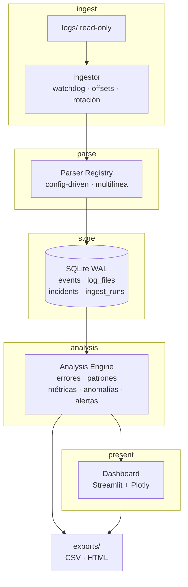

# Enterprise Log Analyzer


Plataforma de observabilidad y análisis de logs para entornos empresariales. Carga logs
de forma incremental, los normaliza, detecta errores críticos, agrupa patrones
recurrentes y expone métricas en un dashboard interactivo con exportación de reportes.

**Estado:** fases 0–6 implementadas. El MVP (0–5) corre en local y la Fase 6 lo
empaqueta en Docker (`analyzer` + `dashboard`). 207 tests, 8 de ellos smoke del
dashboard (se saltan sin Streamlit) — ver [docs/PLAN.md](docs/PLAN.md). Para
instalarlo y ejecutarlo, sigue la [Guía de uso](#guía-de-uso).

---

## Por qué este proyecto no es "otro visor de logs"

Un visor de logs que duplica eventos miente. Este proyecto se construye sobre tres
invariantes, y cada uno tiene una razón concreta:

| Invariante | Problema que resuelve |
|---|---|
| **Idempotencia de ingesta** | Sin ella, reiniciar el watcher duplica eventos y el dashboard reporta números falsos |
| **UTC como storage canónico** | Logs de distintos servicios llegan en zonas distintas; sin normalizar, "errores por hora" es incorrecto |
| **Líneas no parseadas se conservan** | Descartar lo que no se entiende hace la pérdida de datos invisible |

Las decisiones de arquitectura y sus alternativas descartadas están en
[`docs/decisions/`](docs/decisions/).

---

## Arquitectura



En Docker (Fase 6) `Ingestor` y `Dashboard` son **servicios separados**: eso elimina la
contención de escritura de SQLite por diseño, no por ajuste de parámetros.

### Capa de ingesta (añadida al diseño original)

El flujo original iba de `logs/` directo al parser. Eso rompe en producción por dos
motivos, y por eso la ingesta es una capa propia:

- **Tracking de offset**: se lee solo lo nuevo, y se sabe exactamente dónde quedó cada archivo.
- **Detección de rotación**: un log rotado por tamaño se reinicia a 0; si no se detecta,
  todo su contenido se vuelve a insertar.

---

## Estructura

```
Enterprise-Log-Analyzer/
├── app/
│   ├── config.py               Settings tipados · YAML + env
│   ├── ingest/
│   │   ├── reader.py           offset, rotación, ensamblado multilínea
│   │   └── watcher.py          watchdog con debounce
│   ├── parser/
│   │   ├── registry.py         PatternSpec · detect() · parse()
│   │   ├── patterns/           apachev2.yaml · weblogic.yaml · json.yaml
│   │   └── normalization.py    timestamp → UTC · nivel → severity
│   ├── db/
│   │   ├── connection.py       WAL · busy_timeout · contextmanager
│   │   ├── schema.sql  migrations/  repository.py
│   ├── analysis/
│   │   ├── error_rules.yaml     categorías de error · orden = prioridad
│   │   ├── errors.py            ErrorRules · validación al cargar
│   │   ├── fingerprint.py       normalización · sha256
│   │   ├── metrics.py  patterns.py  anomalies.py  backfill.py
│   │   └── __main__.py          CLI: python -m app.analysis
│   ├── ui/
│   │   ├── app.py  views/  components/  theme.py
│   └── reports/                CSV · HTML
├── docs/
│   ├── PLAN.md                 hoja de ruta completa
│   └── decisions/              ADR-001, ADR-002, …
├── logs/                       entrada (read-only en Docker)
├── data/                       app.db
├── exports/                    reportes generados
├── tools/generate_sample_logs.py
├── tests/
│   ├── fixtures/               logs golden por formato
│   └── expected/               JSONL con la salida esperada
├── config.yaml  .env.example
├── requirements.txt  requirements-dev.txt
└── Dockerfile  docker-compose.yml  Makefile
```

---

## Guía de uso

Guía completa para instalar y usar el MVP (fases 0–5). Todo corre localmente con
Python; Docker sólo hace falta para la Fase 6 (post-MVP).

### Requisitos

- **Python 3.12+** — el proyecto se desarrolla y prueba con **3.14**.
- **Git**, para clonar el repositorio.
- (Opcional) **Docker**, para la Fase 6.

### 1. Clonar el repositorio

```bash
# SSH
git clone git@github.com:criseen7/Enterprise-Log-Analyzer.git
# o HTTPS
git clone https://github.com/criseen7/Enterprise-Log-Analyzer.git

cd Enterprise-Log-Analyzer
```

### 2. Instalación

```bash
python3 -m venv .venv
source .venv/bin/activate              # Windows: .venv\Scripts\activate
python -m pip install --upgrade pip
pip install -r requirements.txt -r requirements-dev.txt
```

O, con el atajo del `Makefile`:

```bash
make install
```

Usa siempre el intérprete del entorno virtual; si no lo activas, invócalo como
`.venv/bin/python`.

### 3. Configuración

Todo se declara en `config.yaml`; con los valores por defecto ya funciona. Para
personalizar:

```bash
cp .env.example .env               # overrides por variable de entorno
cp config.yaml config.local.yaml   # overrides locales (no versionado)
```

Las variables de entorno tienen prioridad sobre `config.yaml` y siguen el patrón
`ELA_` + ruta en mayúsculas (`ELA_DB_PATH`, `ELA_LOG_DIR`,
`ELA_POLL_INTERVAL`). La lista completa está en `.env.example`.

### 4. Puesta en marcha (paso a paso)

```bash
# 1. Crear la base de datos y aplicar el esquema
python -m app.db.migrations

# 2. Generar un dataset sintético para el demo (escribe en logs/)
python tools/generate_sample_logs.py

# 3. Ingerir los logs (idempotente: una 2ª pasada inserta 0)
python -m app.ingest --once
python -m app.ingest --status     # cobertura de parseo y últimas pasadas

# 4. Analizar (sin necesidad de dashboard)
python -m app.analysis                  # resumen general
python -m app.analysis --top 8          # errores agrupados por fingerprint
python -m app.analysis --hourly         # errores por hora
python -m app.analysis --anomalies      # z-score sobre el conteo horario
python -m app.analysis --patterns       # patrones de la última ventana
python -m app.analysis --backfill       # rellena la huella de datos antiguos

# 5. Alertas: abrir/actualizar incidentes y exportarlos
python -m app.alerts                    # evalúa la ventana y abre incidentes
python -m app.alerts --list --status OPEN
python -m app.alerts --export csv > incidents.csv

# 6. Lanzar el dashboard
streamlit run app/ui/app.py
```

Versión corta: `make demo` (migra la base + genera logs) y `make dashboard`
levanta el dashboard, que **auto-siembra** si la base está vacía y hay logs en
`logs/`.

### 5. Referencia de comandos

#### Ingesta — `python -m app.ingest`

| Opción | Qué hace |
|---|---|
| `--once` | una pasada y sale (modo por defecto) |
| `--watch` | vigila cambios y sigue ingiriendo (watcher de fondo) |
| `--status` | eventos ingeridos, cobertura de parseo y últimas corridas |
| `--config RUTA` | usar un `config.yaml` alternativo |

#### Análisis — `python -m app.analysis`

| Opción | Qué responde |
|---|---|
| `--overview` | totales del dataset (eventos, parseados, errores, fingerprints) |
| `--top N` | los N errores más repetidos, agrupados por fingerprint |
| `--hourly` | errores por hora en el rango `[since, until)` |
| `--anomalies` | horas anómalas por z-score (sólo picos) |
| `--patterns [--window MIN]` | lo que se repite en la ventana |
| `--backfill [--recalc]` | rellena `fingerprint`/`category` de datos antiguos |

#### Alertas — `python -m app.alerts`

| Opción | Qué hace |
|---|---|
| (sin flags) | evalúa la ventana y abre/actualiza incidentes |
| `--list` | lista los incidentes |
| `--status OPEN\|ACKNOWLEDGED\|RESOLVED` | filtra el listado por estado |
| `--no-evaluate` | no recalcula; sólo lee lo ya persistido |
| `--window MIN` | ventana de evaluación, en minutos |
| `--export csv\|html` | escribe los incidentes en stdout y sale |

#### Migraciones — `python -m app.db.migrations`

| Opción | Qué hace |
|---|---|
| (sin flags) | aplica las migraciones pendientes |
| `--status` | muestra la versión del esquema sin aplicar nada |
| `--db-path RUTA` | sobreescribe `db.path` |

### 6. El dashboard

`streamlit run app/ui/app.py` abre cuatro páginas:

| Página | Contenido |
|---|---|
| **Overview** | KPIs, errores por hora, top errores, heatmap día×hora |
| **Events** | tabla filtrable de eventos (servicio, severidad, texto, sin parsear) |
| **Incidents** | banner de estado, evaluación de la ventana, gestión OPEN/ACK/RESOLVED y export CSV/HTML |
| **Settings** | ingesta manual, backfill y métricas de la propia herramienta |

Los filtros de la barra lateral (rango temporal, servicio, severidad, búsqueda)
aplican a todas las páginas. Los datos siempre se muestran en **UTC**.

Escenario de demo típico:

1. `make demo && make dashboard`
2. En **Overview**, el heatmap y las anomalías muestran el pico horario.
3. En **Incidents**, pulsa **Evaluar ahora**; con suficientes errores por
   fingerprint se abre un incidente.
4. Expórtalo con los botones **CSV** / **HTML** (el CSV abre bien en Excel).

> El dashboard **sólo lee**. Las únicas escrituras (evaluar incidentes, cambiar
> estado, ingerir, backfill) las dispara el usuario desde Incidents y Settings.

### 7. Verificar la instalación

```bash
make test        # o: python -m unittest discover -s tests -t .
make check-db    # debe imprimir: journal_mode = wal

# Golden files: falla si la salida del parser cambió sin regenerarlos.
python -m tests.regenerate_golden --check
python -m tests.regenerate_golden   # regenera (revisar el diff antes de aceptar)
```

### 8. Solución de problemas

| Síntoma | Causa / solución |
|---|---|
| `ModuleNotFoundError: streamlit` | Estás con el Python del sistema. Activa `.venv` o usa `.venv/bin/python`. |
| El dashboard aparece vacío | No hay eventos. Genera logs (`make seed`) e ingiere (`python -m app.ingest --once`); el dashboard también auto-siembra si la base está vacía. |
| `journal_mode` no es `wal` | Ejecuta `make check-db`; si falla, recrea con `make reset-db && make migrate`. |
| Un 2º `ingest` inserta otra vez | No debería: la ingesta es idempotente por `(inode, generation)`. Revisa que no hayas cambiado `log_dir`. |
| Los tests del dashboard se saltan | Falta Streamlit en el intérprete activo (ver el primer punto). |

### 9. Docker (analyzer + dashboard)

La Fase 6 empaqueta la aplicación en dos servicios separados. Requiere Docker con
Docker Compose (o Docker Desktop con integración WSL 2 en Windows).

```bash
make docker-build      # o: docker compose build
make docker-up         # o: docker compose up -d
make docker-logs       # sigue los logs de ambos servicios

# dashboard en http://localhost:8501
make docker-down       # detiene todo; los volúmenes de data/exports persisten
```

- **analyzer** — `python -m app.ingest --watch`: único escritor, monta `./logs`
  en **sólo lectura**.
- **dashboard** — `streamlit run app/ui/app.py`: lee la misma base; espera a que
  `analyzer` esté sano antes de arrancar.
- `data/` y `exports/` viven en **named volumes** (`ela-data`, `ela-exports`):
  sobreviven a `docker compose down` y a reconstruir la imagen. Sólo
  `docker compose down -v` los elimina.

Los contenedores corren como usuario **no-root** y las rutas se inyectan por
variables de entorno (`ELA_DB_PATH=/data/app.db`, `ELA_LOG_DIR=/logs`, …).

Para tener datos en el demo, genera los logs en el host antes de levantar (el
generador no se incluye en la imagen):

```bash
python tools/generate_sample_logs.py
docker compose up -d
```

---

## Stack

| Capa | Tecnología | Razón |
|---|---|---|
| Backend | Python, SQLite | Cero operación; SQLite con WAL resuelve concurrencia lector/escritor |
| Parsing | Regex compilados con *named groups*, config-driven | Agregar un formato es agregar YAML, no código |
| Análisis | SQL + Pandas | Agregación en SQL; nunca cargar la tabla completa en memoria |
| Frontend | Streamlit, Plotly | Dashboard declarativo, heatmap listo |
| Ingesta | watchdog | Detección de cambios en archivos |
| DevOps | Docker, Docker Compose | Servicios separados, volúmenes para `data/` y `exports/` |

---

## Funcionalidades

### En el MVP (fases 0–5)

1. ✅ **Parser inteligente** — detecta `timestamp`, `nivel`, `mensaje`, `servicio`,
   `logger` desde configuración, con normalización a UTC.
2. ✅ **Ingesta idempotente** — offsets, rotación, ensamblado multilínea (stack traces Java).
3. ✅ **Detección de errores críticos** — `timeout`, `connection refused`,
   `null pointer`, `out of memory`, `failed login`, con categorías (reglas en
   YAML) y severidad normalizada.
4. ✅ **Patrones recurrentes** — fingerprint por mensaje normalizado (dígitos, UUIDs,
   IPs y hex colapsan a placeholders) para agrupar lo que en realidad es el mismo
   error, más recurrencia por ventana y anomalías por z-score.
5. ✅ **Dashboard** — KPIs, errores por hora, top errores, timeline, heatmap día×hora (4 páginas: Overview/Events/Incidents/Settings).
6. ✅ **Alertas** — incidentes con dedup por fingerprint y cooldown (vía `notified_at`); banner + lista y estados OPEN/ACK/RESOLVED en el dashboard; export CSV (utf-8-sig) y HTML autocontenido; CLI `python -m app.alerts`.
7. **Métricas de la propia herramienta** — `ingest_runs` ya se registra en cada
   pasada; el panel llega con el dashboard.

### Post-MVP (backlog, ver [docs/PLAN.md](docs/PLAN.md) §6)

- Formato IIS
- Anomalías avanzadas (IQR, estacionalidad)
- Correlación de eventos
- Búsqueda estilo Splunk
- Export PDF · auth · multi-tenancy · PostgreSQL · Prometheus

---

## Formatos soportados

Cada formato es **un archivo YAML** en `app/parser/patterns/`. Agregar IIS o
WebLogic es agregar un archivo, no escribir Python — ver
[ADR-002](docs/decisions/ADR-002-parsers-declarativos.md).

| Formato | `kind` | Estado |
|---|---|---|
| Apache / Nginx (CLF) | `regex` | ✅ implementado |
| JSON (una línea por registro) | `json` | ✅ implementado |
| WebLogic / java.util.logging | `regex` | ✅ implementado (multilínea) |
| IIS | `regex` | backlog |

Un patrón `regex` **debe** declarar el grupo con nombre `ts`; `level`, `service`,
`logger`, `status` y `message` son opcionales. El contrato se verifica al cargar
los patrones, no durante la ingesta: un YAML incompleto rompe el arranque.

Para JSON se declaran listas de claves candidatas por campo, con rutas de punto:

```yaml
fields:
  level: [level, levelname, severity, loglevel, log.level]
  message: [message, msg, '@message', log, log.message]
```

---

## Sistema de severidad

Niveles crudos (diferentes por formato) se normalizan a una escala única:

```
TRACE 10 · DEBUG 20 · INFO 30 · WARN 40 · ERROR 45 · FATAL 50 · UNKNOWN 0
```

`UNKNOWN` se asigna a líneas no parseadas. Se conservan y se hacen visibles en el
dashboard como "cobertura de parseo", en lugar de descartarse en silencio.

---

## Clasificación y agrupación

Dos preguntas distintas, dos columnas nuevas en `events`:

- **`category` — ¿qué tipo de problema es?** Sale de
  `app/analysis/error_rules.yaml`: una lista ordenada donde **gana la primera
  regla que coincide** (`failed login` → `auth`, `connection refused` →
  `connection`, 5xx → `http-5xx`). Añadir una categoría es añadir una regla,
  no código. Un YAML mal formado falla **al cargar**, nunca durante la ingesta.
- **`fingerprint` — ¿es otra vez el mismo error?** `sha256` truncado a 16 hex
  sobre `categoría + mensaje normalizado`, donde lo que varía entre ejecuciones
  se sustituye por `<UUID> <TS> <IP> <HEX> <NUM>`. 100 accesos fallidos que
  sólo cambian en `code=` son **1** fingerprint, no 100 barras de una unidad.

El orden de esas sustituciones y las alternativas descartadas están en
[ADR-004](docs/decisions/ADR-004-event-fingerprint.md).

### Métricas

Todo se agrega en SQL; ninguna carga la tabla `events` entera en memoria.

| Comando | Qué responde |
|---|---|
| `python -m app.analysis` / `--overview` | cuántos eventos, cuántos parseados, cuántos errores, fingerprints distintos |
| `--hourly` | errores por hora, rango `[since, until)` |
| `--top N` | los N errores más repetidos, agrupados por fingerprint |
| `--patterns --window MIN` | qué se repite en la ventana; por defecto acaba en el **último evento** del dataset, no en el reloj |
| `--anomalies` | qué hora se sale de lo normal: z-score leave-one-out, sólo picos |
| `--backfill [--recalc]` | rellena `fingerprint`/`category` de datos antiguos; `--recalc` reescribe lo ya clasificado |

---

## Recursos

- [APRENDIZAJE.md](APRENDIZAJE.md) — decisiones y trampas encontradas, fase por fase.
- [docs/decisions/](docs/decisions/) — ADRs con contexto y alternativas descartadas.
- [docs/PLAN.md](docs/PLAN.md) — hoja de ruta y criterios de aceptación.

---

## Licencia

Distribuido bajo la [Licencia MIT](LICENSE).

Copyright (c) 2026 Cristofer Hernandez
