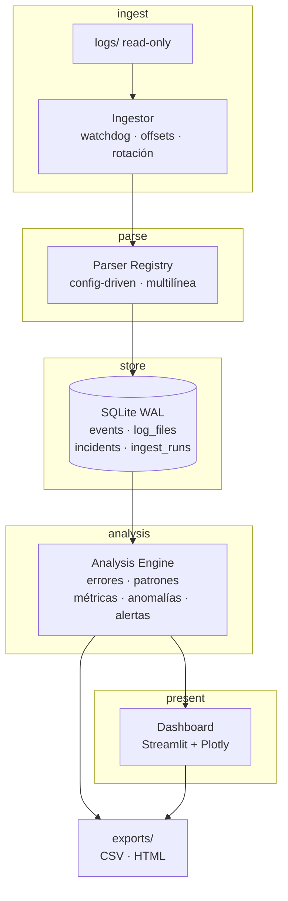

# Enterprise Log Analyzer

Plataforma de observabilidad y análisis de logs para entornos empresariales. Carga logs
de forma incremental, los normaliza, detecta errores críticos, agrupa patrones
recurrentes y expone métricas en un dashboard interactivo con exportación de reportes.

**Estado:** en desarrollo activo. Fase 0 (cimientos) completada — ver [docs/PLAN.md](docs/PLAN.md).

---

## Por qué este proyecto no es "otro visor de logs"

Un visor de logs que duplica eventos miente. Este proyecto se construye sobre tres
invariantes, y cada uno tiene una razón concreta:

| Invariante | Problema que resuelve |
|---|---|
| **Idempotencia de ingesta** | Sin ella, reiniciar el watcher duplica eventos y el dashboard reporta números falsos |
| **UTC como storage canónico** | Logs de distintos servicios llegan en zonas distintas; sin normalizar, "errores por hora" es incorrecto |
| **Líneas no parseadas se conservan** | Descartar lo que no se entiende hace la pérdida de datos invisible |

Las decisiones de arquitectura y sus alternativas descartadas están en
[`docs/decisions/`](docs/decisions/).

---

## Arquitectura



En Docker (Fase 6) `Ingestor` y `Dashboard` son **servicios separados**: eso elimina la
contención de escritura de SQLite por diseño, no por ajuste de parámetros.

### Capa de ingesta (añadida al diseño original)

El flujo original iba de `logs/` directo al parser. Eso rompe en producción por dos
motivos, y por eso la ingesta es una capa propia:

- **Tracking de offset**: se lee solo lo nuevo, y se sabe exactamente dónde quedó cada archivo.
- **Detección de rotación**: un log rotado por tamaño se reinicia a 0; si no se detecta,
  todo su contenido se vuelve a insertar.

---

## Estructura

```
Enterprise-Log-Analyzer/
├── app/
│   ├── config.py               Settings tipados · YAML + env
│   ├── ingest/
│   │   ├── reader.py           offset, rotación, ensamblado multilínea
│   │   └── watcher.py          watchdog con debounce
│   ├── parser/
│   │   ├── registry.py         PatternSpec · detect() · parse()
│   │   ├── patterns/           apachev2.yaml · iis.yaml · weblogic.yaml · json.yaml
│   │   └── normalization.py    timestamp → UTC · nivel → severity
│   ├── db/
│   │   ├── connection.py       WAL · busy_timeout · contextmanager
│   │   ├── schema.sql  migrations/  repository.py
│   ├── analysis/
│   │   ├── errors.py  patterns.py  metrics.py  anomalies.py  alerts.py
│   ├── ui/
│   │   ├── app.py  pages/  components/  theme.py
│   └── reports/                CSV · HTML
├── docs/
│   ├── PLAN.md                 hoja de ruta completa
│   └── decisions/              ADR-001, ADR-002, …
├── logs/                       entrada (read-only en Docker)
├── data/                       app.db
├── exports/                    reportes generados
├── tools/generate_sample_logs.py
├── tests/
│   ├── fixtures/               logs golden por formato
│   └── expected/               JSONL con la salida esperada
├── config.yaml  .env.example
├── requirements.txt  requirements-dev.txt
└── Dockerfile  docker-compose.yml  Makefile
```

---

## Configuración

Todo se declara en `config.yaml`; las variables de entorno tienen prioridad para permitir
overrides en Docker sin editar archivos.

```bash
cp .env.example .env
cp config.yaml config.local.yaml   # opcional: overrides locales
```

Las claves de entorno siguen el patrón `ELA_` + ruta en mayúsculas:
`ELA_DB_PATH`, `ELA_LOG_DIR`, `ELA_POLL_INTERVAL`.

---

## Puesta en marcha

```bash
python -m venv .venv && source .venv/bin/activate
pip install -r requirements.txt -r requirements-dev.txt

# 1. Crear la base de datos y aplicar el esquema
python -m app.db.migrations

# 2. Generar un dataset sintético para el demo
python tools/generate_sample_logs.py

# 3. Lanzar el dashboard
streamlit run app/ui/app.py
```

O en un solo paso: `make demo`.

### Verificar la instalación

```bash
make test        # o: python -m unittest discover tests -v
make check-db    # debe imprimir: journal_mode = wal
```

---

## Stack

| Capa | Tecnología | Razón |
|---|---|---|
| Backend | Python, SQLite | Cero operación; SQLite con WAL resuelve concurrencia lector/escritor |
| Parsing | Regex compilados con *named groups*, config-driven | Agregar un formato es agregar YAML, no código |
| Análisis | SQL + Pandas | Agregación en SQL; nunca cargar la tabla completa en memoria |
| Frontend | Streamlit, Plotly | Dashboard declarativo, heatmap listo |
| Ingesta | watchdog | Detección de cambios en archivos |
| DevOps | Docker, Docker Compose | Servicios separados, volúmenes para `data/` y `exports/` |

---

## Funcionalidades

### En el MVP (fases 0–5)

1. **Parser inteligente** — detecta `timestamp`, `nivel`, `mensaje`, `servicio`, `logger`
   desde configuración, con normalización a UTC.
2. **Ingesta idempotente** — offsets, rotación, ensamblado multilínea (stack traces Java).
3. **Detección de errores críticos** — `timeout`, `connection refused`, `null pointer`,
   `out of memory`, `failed login`, con categorías y severidad normalizada.
4. **Patrones recurrentes** — fingerprint por mensaje normalizado (UUIDs, IPs, hex y
   dígitos y UUIDs colapsan a placeholders) para agrupar lo que en realidad es el mismo error.
5. **Dashboard** — KPIs, errores por hora, top errores, timeline, heatmap día×hora.
6. **Alertas** — incidentes con dedup por fingerprint y cooldown; export CSV/HTML.
7. **Métricas de la propia herramienta** — `ingest_runs` visible para demostrar que
   los números del dashboard son auditables.

### Post-MVP (backlog, ver [docs/PLAN.md](docs/PLAN.md) §6)

- Formatos IIS y WebLogic (y el problema de multilínea de Oracle)
- Anomalías avanzadas (IQR, estacionalidad)
- Correlación de eventos
- Búsqueda estilo Splunk
- Export PDF · auth · multi-tenancy · PostgreSQL · Prometheus

---

## Sistema de severidad

Niveles crudos (diferentes por formato) se normalizan a una escala única:

```
TRACE 10 · DEBUG 20 · INFO 30 · WARN 40 · ERROR 45 · FATAL 50 · UNKNOWN 0
```

`UNKNOWN` se asigna a líneas no parseadas. Se conservan y se hacen visibles en el
dashboard como "cobertura de parseo", en lugar de descartarse en silencio.

---

## Qué aprendí

Las decisiones están en [`docs/decisions/`](docs/decisions/). Lo ya verificado en
la Fase 0:

- **WAL no es un detalle de configuración**: cambia el modelo de concurrencia entero.
  Un test de estrés *no* lo demuestra (SQLite aguanta escrituras cortas incluso en
  `DELETE`); lo demuestra el escenario determinista de un lector con transacción
  abierta bloqueando el `COMMIT` del escritor.
- **La idempotencia se diseña antes que el watcher**, no después. El orden importa.
- **`executescript()` hace un COMMIT implícito**: envolverlo en una transacción
  explícita falla.
- **Normalizar el timestamp es un problema de datos, no de formato.**

Los siguientes puntos del plan (idempotencia en la práctica, timezone, multilínea,
`cache_data`) se documentarán en `docs/pitfalls.md` al sealing de las fases 1–5.

---

## Licencia

Por definir.